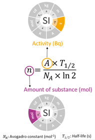

# Mass Spectrometry

{: .lead }
**B. Russell**\
<ben.russell@npl.co.uk>\
National Physical Laboratory (NPL), Hampton Road, Teddington, Middlesex, TW11 0LW, UK

Mass spectrometry is increasingly being applied to the measurement of radionuclides at low levels for applications including nuclear decommissioning, environmental monitoring, nuclear forensics and nuclear medicine. The purpose of the sub-group is to investigate the radionuclides measurable by mass spectrometry, the relative advantages and limitations of different techniques, the availability of standards and reference materials and the traceability of this technique for radioactivity measurement.  

Mass spectrometry is increasingly presented at both the ICRM and Low Level Radionuclide Measurement Technique meetings. At the most recent low level meeting in Ottawa ([2026 Conference](https://icrmllrmt2026.vfairs.com/)), for the first time, there was a day of the conference dedicated to mass spectrometry measurement. Presentations included low-level measurement of radionuclides including 2H, 210Pb, 226Ra, 227Ac and isotopic ratios of U and Pu, as well as outputs from wider mass spectrometry-led work including the Euramet [MetroPOEM](https://www.npl.co.uk/euramet/metropoem) project and the CCRI(II) Mass Spectrometry [Task Group](https://www.bipm.org/en/committees/cc/ccri/wg/ccri-ii-ms-tg).

